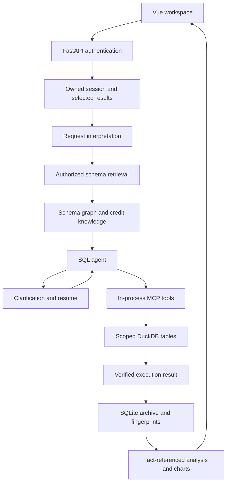

# Architecture and code analysis

## Purpose and boundaries

CreditLens is a single-domain retail credit analytics prototype. It translates Chinese business questions into authorized queries over synthetic operational records and exposes the evidence behind the answer. The full application consists of a Vue/TypeScript workspace, a FastAPI service, LangGraph orchestration, an in-process MCP server, a scoped DuckDB execution connection, and a SQLite session archive.

The two execution modes deliberately share authorization, SQL execution, and persistence. Demo mode selects a defined metric and compiles SQL; model mode generates SQL from retrieved schema context. Demo success does not establish the quality of a real model.

## Request flow

1. The API resolves a server-side identity from a bearer token. Client-supplied usernames cannot choose query permissions.
2. The service reads recent owned tasks and normalizes selected field/result IDs. Prior context is reused only while the permission scope still matches.
3. Request interpretation chooses a new query, analysis of stored results, or a direct response. The model path receives a standalone question, dataset metadata, and explicit time context.
4. Schema retrieval filters candidates by access scope, combines lexical and dense ranking, reranks candidates, and builds a join graph. The shared index stores metadata rather than business rows.
5. The SQL agent discovers permitted MCP tools and has a six-call budget. It can retrieve more schema, inspect data, request clarification, or execute a final query. Missing schema cannot be bypassed by guessing a query.
6. The query engine validates the SQL tree and creates an isolated in-memory database containing only the authorized rows and columns. Unrestricted staging tables are removed before user SQL runs.
7. Successful results retain SQL, scope and result fingerprints, column types, data version, cutoff date, and truncation status. Analysis failures preserve successfully executed results.
8. Analysis resolves fact references against server-owned results. Decimal calculations and chart validation reduce unsupported numerical claims, but do not prove the correctness of all prose or business semantics.

## Module map

| Module | Main implementation | Responsibility |
| --- | --- | --- |
| API and configuration | `backend/app/api/routes.py`, `config.py`, `models.py` | Authentication boundaries, request contracts, local configuration, and public status |
| Domain schema | `credit/schema.py`, `database.py` | Twelve tables, field types, grain, relationships, and sensitive-field metadata |
| Synthetic data | `demo_data.py`, `seed_demo_data.py` | Deterministic operational events, schedules, allocations, snapshots, and content hashes |
| Metric demo | `credit/metrics.py`, `plan.py`, `planner.py`, `compiler.py` | Thirteen metric definitions, date and dimension resolution, clarification, and validated SQL compilation |
| Domain knowledge | `credit/knowledge.py` | Definitions and reference SQL, including historical state reconstruction |
| Authorization | `security/auth.py`, `access_control.py` | Local demo identities, institution scopes, field restrictions, and scope fingerprints |
| SQL execution | `querying/duckdb_engine.py` | AST validation, scoped data loading, resource limits, exact numeric serialization, and a 200-row result cap |
| Model access | `model_client.py` | Chat, embedding, and rerank clients; TLS verification, explicit external-request gate, retries, and circuit breaking |
| Retrieval | `retrieval/store.py`, `service.py`, `graph.py` | Local field index, BM25/dense retrieval, RRF, reranking, and authorized relationship expansion |
| Application skills | `skills/registry.py` and skill files | Prompt instructions, allowed tools, output actions, and call budgets |
| MCP runtime | `mcp_runtime/` | Structured schema search, read-only SQL, date tools, and chart specifications without an additional server port |
| Query and analysis agents | `querying/single_database_agent.py`, `data_qa_agent.py` | Bounded SQL correction, clarification, grounded reports, and checked calculations |
| Workflow | `workflows/query_graph.py`, `state.py`, `result_builder.py` | LangGraph routing, interrupts, resume, and consistent result metadata |
| Persistence | `services/session_archive.py`, `session_context.py`, `askdata_service.py` | Owned tasks, saved fields/results, permission-aware context, and restart recovery |
| Frontend | `frontend/src/App.vue`, `api.ts`, `components/` | Login, schema exploration, conversation, result tables, SQL/evidence inspection, report cards, and charts |
| Validation | `backend/tests/`, `backend/scripts/` | Offline regressions, scripted model contracts, independent references, optional live runs, and SQL counterexamples |

## Data model and financial semantics

The dimensions are customers, products, channels, and institutions. Applications link to approval events and loans. Loans link to disbursements, repayment schedules, and repayment transactions; allocations connect received money to schedules. Daily loan snapshots provide a reproducible reference for historical balances and overdue measures.

The default generator produces 400 customers, 1,200 applications, 886 loans, and 260,922 daily snapshots. The seed, coverage dates, table counts, and CSV hashes are written into the dataset manifest. The generated dataset has version `0f974d296f352e6a`. No real borrower data is needed.

Important semantic distinctions are explicit in the metric catalog and knowledge:

- Principal and interest remain separate, using DECIMAL values rather than floating-point money.
- Reversal rows already carry signed values; they must not be negated a second time.
- Period flows and point-in-time balances use different date semantics. Daily balances must not be summed to produce a month-end balance.
- First borrowers are based on the first net-positive disbursement, not simply the earliest raw event.
- Overdue due principal differs from the full balance of overdue loans. DPD depends on the earliest unpaid due installment under the synthetic model.
- One-to-many facts must be aggregated to the intended grain before joins. Zero denominators yield null rather than a manufactured zero rate.

For arbitrary model-generated SQL these rules are guidance, not a complete semantic verifier. Event-based historical reconstruction is also available without loading the daily snapshot table; production cases such as restructuring and migrated balances are not modeled.

## State and trust boundaries

Tokens are process-local, while task ownership and results persist in SQLite. Clarification resumes from LangGraph memory when available and rebuilds pending work from the persisted payload after restart. A changed permission scope invalidates historical context or selected results instead of silently broadening access.

Reports accept up to five result IDs. The backend reloads the actual results and checks ownership, scope, data version, and cutoff date; a client-provided table is not accepted as trusted evidence. Fact references identify source cells, metadata, and checked calculations. Truncated results cannot be treated as complete populations for report calculations.

The SQL connection limits execution to a single SELECT/WITH query, blocks writes, external reads, dynamic table functions, internal tables, and unregistered functions, and applies memory/thread/time limits. These controls and their regression tests are useful prototype protections, not a production database sandbox certification.

## Release scope and implementation decisions

The public tree contains application code, application skills, tests, benchmark definitions, dependency locks/constraints, and documentation. Runtime environments, real `.env` files, session databases, provider traces, old build outputs, and the historical source ZIP are excluded. The complete synthetic dataset is generated rather than stored in Git.

Preparation keeps the application behavior intact. Packaging changes rename frontend/MCP display identifiers, provide a portable launcher, make benchmark questions independent of a local writeup, and add repeatable CI. The original directory is preserved separately.

## Current limitations and next work

The recorded live baseline exposes errors in model action format, SQL enum/status handling, cohort definitions, ratio precision, necessary clarification, and cross-session report routing. Improving these behaviors should precede adding more domains or a larger UI.

A practical next sequence is: add held-out semantic counterexamples; improve clarification and report routing; repeat the same live evaluation under fixed configuration; then add independent review and load testing. Production use would also require real identity management, deployment hardening, full pagination/export, audit retention, and a reviewed data-governance model. MySQL integration, model training, and credit scoring are outside the current implementation.
